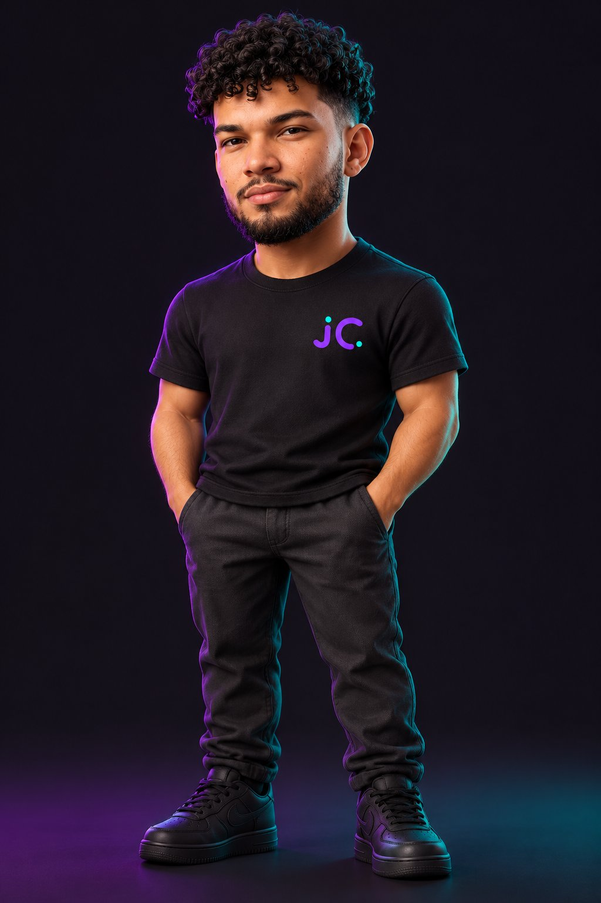

<div align="center">



# jc. · João Cláudio | Soluções Digitais

### Design · Tecnologia · Criação

Sites, sistemas, identidade visual, vídeos, papelaria personalizada e impressão 3D.
📍 Goiânia/GO · atendimento presencial e remoto

<br>

[](https://joaodias3ds.github.io/portfolio/)
[](https://joaodias3ds.github.io/curriculo/)
[](https://wa.me/5562995551544?text=Ol%C3%A1%2C%20Jo%C3%A3o!%20Gostaria%20de%20conversar%20sobre%20um%20projeto.)

[](https://github.com/joaodias3ds/portfolio/actions/workflows/pages.yml)


</div>

---

## 📑 Sumário

- [Sobre](#-sobre)
- [Serviços](#-serviços)
- [Seções do site](#-seções-do-site)
- [Funcionalidades](#-funcionalidades)
- [Estrutura](#-estrutura)
- [Como rodar e atualizar](#-como-rodar-e-atualizar)
- [Contato](#-contato)
- [Autor](#-autor)

---

## 👋 Sobre

Este é o portfólio da **jc.**, a marca de soluções digitais de **João Cláudio Moreira Dias**, tecnólogo em Análise e Desenvolvimento de Sistemas pela Faculdade Senac Goiás e pós-graduando em Governança em TI e Cybersecurity.

O trabalho conecta **tecnologia, comunicação e criação**: do desenvolvimento de sites e sistemas à identidade visual, ao vídeo e a peças físicas com modelagem e impressão 3D.

---

## 🧰 Serviços

| # | Serviço | O que inclui |
|---|---|---|
| 01 | 💻 **Sites & sistemas** | Sites e sistemas personalizados, responsivos para computador e celular |
| 02 | 🎨 **Logos & identidade visual** | Logos e elementos visuais consistentes para a marca |
| 03 | 🎬 **Vídeos & redes sociais** | Produção e edição de vídeos, artes, planejamento de conteúdo e gestão de redes |
| 04 | ✉️ **Papelaria & personalizados** | Materiais personalizados para marcas, eventos e comemorações |
| 05 | 🧊 **Modelagem & impressão 3D** | Modelagem e impressão de peças sob medida |
| 06 | 🛠️ **Suporte & implantação** | Instalação e configuração de softwares, suporte ao usuário e implantação de sistemas |

---

## 🗺️ Seções do site

1. **Capa:** título "Portfólio" com o personagem 3D e as especialidades.
2. **Apresentação:** quem sou, formação e link para o currículo.
3. **Serviços:** os seis serviços, cada um com um botão direto para o WhatsApp.
4. **Projetos:** as frentes Digital, Visual e Físico.
5. **Trajetória:** formação acadêmica e experiências recentes.
6. **Contato:** e-mail, Instagram, LinkedIn, GitHub e botão de orçamento.

---

## ✨ Funcionalidades

- 📱 **Responsivo**, com menu próprio para celular (abre e fecha, e fecha também com `Esc`).
- ♿ **Acessível:** link "Pular para o conteúdo", foco visível, `aria-labels` e respeito a `prefers-reduced-motion`.
- 💬 **Orçamento em um clique:** cada serviço abre o WhatsApp com uma mensagem pronta.
- 🔎 **SEO e prévia social:** título, descrição, favicon e Open Graph, que geram um card com imagem ao compartilhar o link.
- ⚡ **Leve:** HTML, CSS e JavaScript puros, sem frameworks e sem build.
- 🚀 **Deploy automático** no GitHub Pages via GitHub Actions a cada `push` na `main`.

---

## 🗂️ Estrutura

```
portfolio/
├── index.html                  # Página do portfólio (HTML + CSS + JS)
├── assets/
│   └── personagem.jpg          # Personagem 3D da capa
├── .github/
│   └── workflows/
│       └── pages.yml           # Publicação no GitHub Pages
├── .gitattributes
└── README.md
```

---

## 💻 Como rodar e atualizar

**Para ver no computador:**

```bash
git clone https://github.com/joaodias3ds/portfolio.git
cd portfolio
```

Depois, abra o `index.html` no navegador. Não é preciso instalar nada.

**Para publicar uma alteração:**

```bash
git add .
git commit -m "Atualiza portfólio"
git push
```

Em cerca de 1 minuto, o site em **https://joaodias3ds.github.io/portfolio/** é atualizado sozinho.

> 💡 **Projetos:** quando quiser mostrar trabalhos reais, substitua o bloco marcado com o comentário `PROJETOS` no `index.html` e coloque as imagens em `assets/`.

---

## 📬 Contato

| | |
|---|---|
| 💬 WhatsApp | [(62) 99555-1544](https://wa.me/5562995551544) |
| 📧 E-mail | [jcmoreiradias29@gmail.com](mailto:jcmoreiradias29@gmail.com) |
| 📸 Instagram | [@jcsolucoesgo](https://www.instagram.com/jcsolucoesgo/) |
| 💼 LinkedIn | [linkedin.com/in/joaoclaudiodias-ti](https://www.linkedin.com/in/joaoclaudiodias-ti/) |
| 📄 Currículo | [joaodias3ds.github.io/curriculo](https://joaodias3ds.github.io/curriculo/) |

---

## 👤 Autor

<table>
  <tr>
    <td align="center">
      <a href="https://github.com/joaodias3ds">
        <br>
        <b>João Cláudio Moreira Dias</b>
      </a><br>
      <sub>Autor e mantenedor</sub>
    </td>
  </tr>
</table>

---

<div align="center">

© 2026 João Cláudio Moreira Dias · jc. Soluções digitais. Todos os direitos reservados.
O conteúdo deste portfólio (textos, imagens e marca) não pode ser reutilizado sem autorização.

</div>
